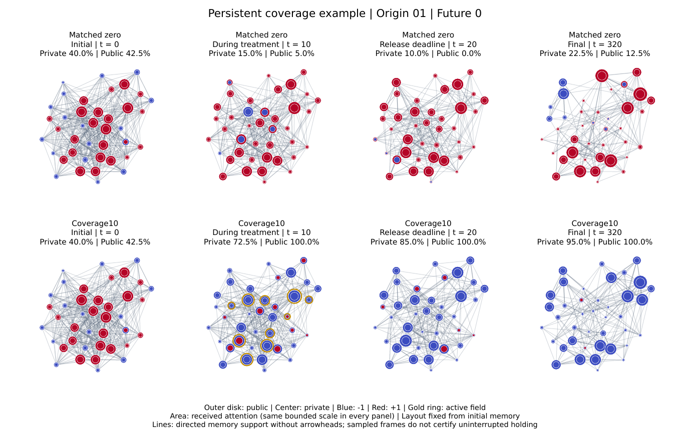
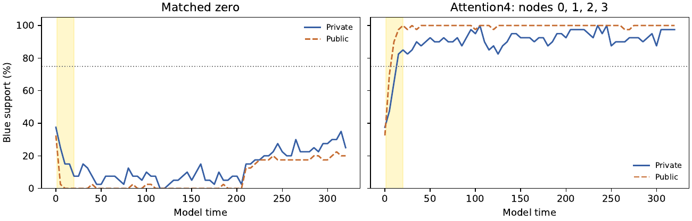
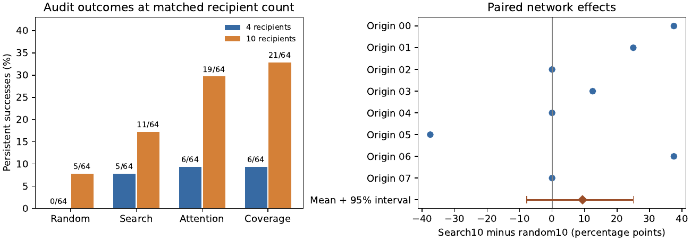
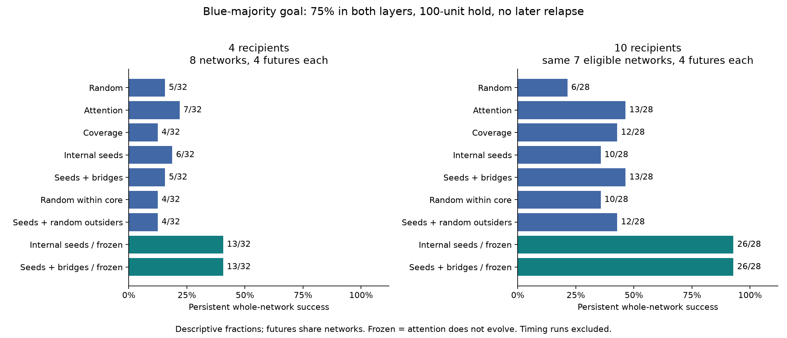
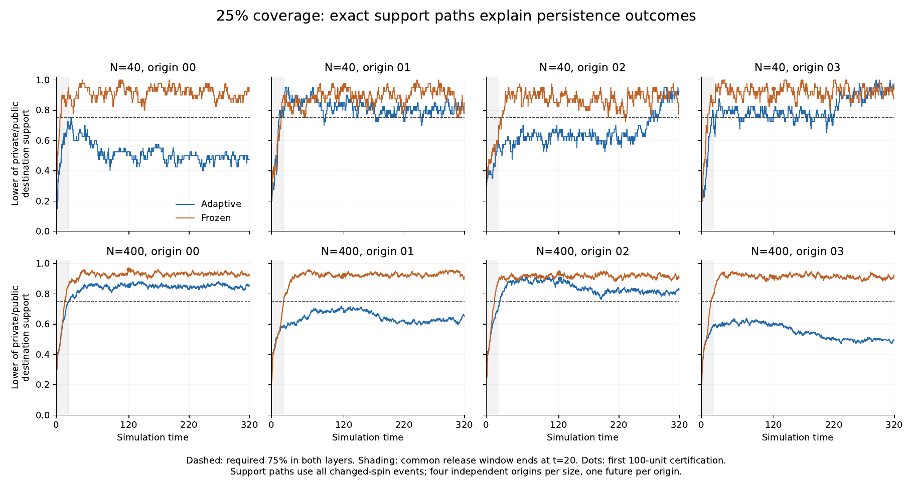

# Hierarchy and Collective Order in Adaptive Stochastic Networks

[](https://www.python.org/downloads/)
[](LICENSE)

A statistical-physics simulation framework for studying **persistent transformation of established collective states** in adaptive stochastic networks. The model explores how bounded interventions can move heterogeneous agent populations from one configuration to another, and whether the new state persists after forcing ends.

## Key Features

- **Dual-layer agent states** — private beliefs and public expressions with tunable coupling
- **Adaptive memory networks** — directed attention weights that evolve through stochastic encounters, reinforcement, and forgetting
- **Heat-bath dynamics** — Glauber (binary) and inverse-CDF (continuous) update rules at finite temperature
- **Intervention optimization** — budget-constrained control policies under partial observability
- **Rich analytics** — influence concentration, community detection (Leiden), rank persistence, network animations

## Summary of Results

The experiments use constructed populations of 40 and 400 agents. Each agent holds a private and a public binary position, and the population starts with a red majority. A temporary field is applied to a subset of agents and then removed. A run succeeds only if at least 75% of agents are blue in **both** layers, hold that for 100 uninterrupted time units after the field is removed, and do not relapse before the end of the run.

**Main finding: treating a minority of the network can transform the whole network permanently.**

- **Four agents are enough.** A field on 4 of 40 agents (10%) took one network from 15/40 private and 13/40 public blue to 39/40 and 40/40. The network crossed the target at t ≈ 13 and stayed there until the end of the run at t = 320. The same network without intervention did not get there.
- **It holds across networks.** Treating 10 agents chosen by audience coverage produced persistent transformation on 7 of 8 independent networks, in 21 of 64 runs. The untreated runs had no successes.
- **It holds at larger scale.** Treating 25% of agents by coverage produced persistent transformation at both 40 and 400 agents: 4/4 runs at N = 400 with fixed memory and 2/4 with adaptive memory.
- **Network adaptation resists change.** When the memory network is held fixed, the transformation persists much more often (for example 26/28 against 13/28). Adapting attention partly undoes the intervention after it is removed.

**Which targeting strategies work:**

- Simple rules (choosing agents with the highest observed attention, or covering the widest audience) worked as well as a simulation-assisted search for the best group.
- Recruiting weakly connected agents one at a time, including a policy that adapts to how they respond, never reached the 75% endpoint. Intervening on several agents at once is what works.
- At 400 agents, treating 10% did not produce lasting change, while treating 25% did. These runs vary reach and dose together, so the experiments do not separate the two.

All results come from a synthetic model, and attention in the model is not institutional authority.

### Representative figures

**A transformation achieved on one network.** Same initial population and same future, with no intervention (top) and with a temporary field on 10 audience-coverage recipients (bottom). Blue/red: position −1/+1; outer disk is the public position and the centre the private one; gold rings mark agents under an active field; disk area is received attention.



**Trajectory of the reversal.** Share of agents holding the destination (blue) in the private and public layers, without intervention (left) and with a field on four attention-ranked agents (right). The shaded band is the treatment window and the dotted line the 75% persistence threshold.



**How often it persists.** Persistent whole-network successes in the audit at matched recipient counts, and the paired per-network difference between searched and random targeting (right). Effects vary strongly across networks and the interval includes zero.



**Persistence by strategy in the nucleation study.** Persistent whole-network success by targeting strategy with 4 and 10 recipients. Teal bars are variants with frozen attention (memory does not evolve). Fractions are descriptive; futures share networks.



**Scale comparison.** Support paths for 25% coverage at 40 and 400 agents, adaptive versus frozen memory; four independent networks per size.



## Core Model

Agent $i = 1, \ldots, N$ has private and expressed components $x_{i\alpha}, y_{i\alpha}$ with $\alpha = 1, \ldots, D$. Values are binary $\{-1, +1\}$ or continuous in $[-1, 1]$.

### Memory and Attention

$W_{ij}$ is an integer count of remembered encounters in which $i$ attends to $j$. The normalized attention and received attention are:

$$
A_{ij} = \frac{W_{ij}}{S_i}, \quad r_j = \sum_i A_{ij}
$$

### Fields

$$
F^y_{i\alpha} = J \sum_j A_{ij} y_{j\alpha} + K_i x_{i\alpha} + h_{i\alpha}(t) + g_i u_{i\alpha}(t)
$$

$$
F^x_{i\alpha} = K_i y_{i\alpha} + L \sum_{\beta \ne \alpha} B_{\alpha\beta} x_{i\beta} + b_{i\alpha}
$$

### Heat-Bath Updates

Binary states use Glauber dynamics; continuous states use an inverse-CDF sampler:

$$
P(z' = s \mid F) = \frac{e^{Fs/T}}{2\cosh(F/T)} \quad (s = \pm 1)
$$

### Encounter Dynamics

Agents select interaction partners through a mixture of uniform exploration and biased reinforcement:

$$
P_{ij} = \varepsilon \, U_{ij} + (1 - \varepsilon) \, V_{ij}
$$

where $V_{ij}$ incorporates prestige bias, opinion similarity, and existing tie strength.

### Control Problem

Optimize bounded interventions to achieve persistent state transformation under partial observability:

$$
\min_{\pi} \mathbb{E}_\pi[\min(T_G, H)] \quad \text{subject to} \quad P_\pi(T_G \le H) \ge p_0
$$

Subject to constraints on the number of controlled nodes ($k$), forcing amplitude ($u_{\max}$), total budget ($\mathcal{B}$), and intervention duration ($T_c$).

## Project Structure

```
src/
├── core/           # States, fields, heat baths, memory, scheduler
├── config/         # Profiles, schemas, scenario definitions
├── control/        # Controllers, policies, optimizers, checkpointing
├── experiment/     # Generators, interventions, baselines
├── analytics/      # Influence, communities, discrepancy measures
├── visualization/  # Plots, network layouts, animations
├── campaigns/      # Campaign orchestration
├── execution/      # Trajectory runner
└── io/             # Results I/O

tests/
├── unit/           # Unit tests
├── e2e/            # End-to-end feature and scenario tests
└── integration/    # Integration tests

research/           # Model and measurement specifications, scenario definition
tools/              # Command-line checks and smoke runs
images/             # Representative result figures
```

## Quick Start

### Installation

```bash
git clone https://github.com/oscfer/complex-systems-project.git
cd complex-systems-project
pip install -e ".[dev]"
```

### Run Tests

```bash
pytest tests/ -q
```

### Basic Usage

```python
import numpy as np
from src.config.profiles import LIGHT_PROFILES, build_realism_runner

# One heterogeneous population of 40 agents with adaptive memory
profile = LIGHT_PROFILES["campaign"].model_copy(update={"N": 40})
runner = build_realism_runner(profile, origin_seed=1)

# Simulate 20 time units of stochastic updates, encounters and forgetting
trajectory = runner.run(horizon=20.0)
state = trajectory.final_state
print("public mean:", np.mean(state.y), "private mean:", np.mean(state.x))
print("remembered encounters:", int(state.W.sum()))
```

## Measurements

Key observables include:

| Observable | Description |
|---|---|
| Component means | $\langle x_\alpha \rangle$, $\langle y_\alpha \rangle$ over agents |
| Discrepancy | $d_2 = \frac{1}{4ND} \sum_{i\alpha} (x_{i\alpha} - y_{i\alpha})^2$ |
| Influence concentration | $C_N = (NC - 1)/(N - 1)$ where $C = \sum_j p_j^2$ |
| Community structure | Leiden algorithm on symmetrized $W + W^\top$ |
| Rank persistence | Spearman correlation of influence rankings over time |

## Documentation

- **[Research Specifications](research/)** — mechanism and measurement specifications and the scenario definition

## Citation

If you use this code in your research, please cite:

```bibtex
@software{modular3_2026,
  title  = {Hierarchy and Collective Order in Adaptive Stochastic Networks},
  author = {Oscar Gonzalez},
  year   = {2026},
  url    = {https://github.com/oscfer/complex-systems-project}
}
```

## License

All rights reserved. This repository is published for viewing and evaluation only; see [LICENSE](LICENSE).
